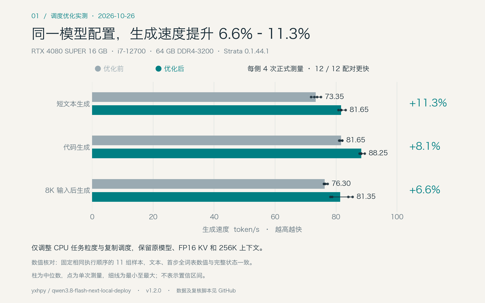
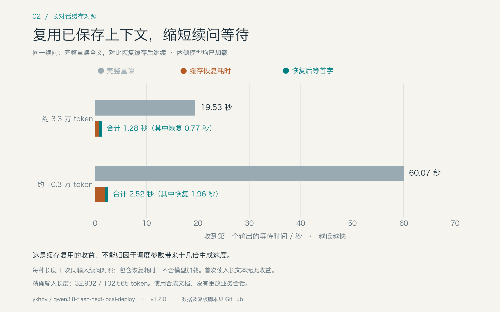
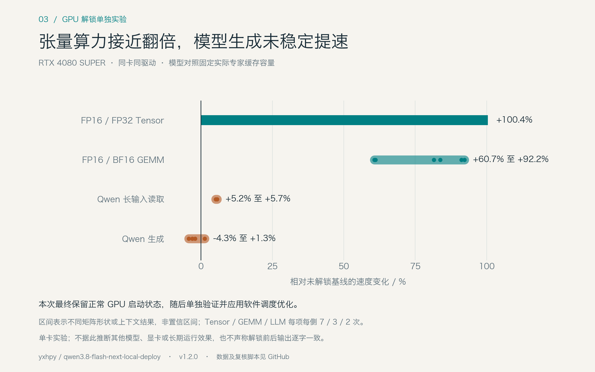

# RTX 4080 SUPER 上的 Qwen3.8-Flash-Next 调度与缓存实测

2026-10-26，在 RTX 4080 SUPER 16 GB、i7-12700、64 GB DDR4-3200 上，保留原模型、量化、FP16 KV、262144 上下文和线上采样设置，只调整 CPU 任务粒度和专家数据复制的调度。实际配置对照中，三类任务的生成速度中位数提高 **6.6%–11.3%**，12 组配对全部更快。最终已应用这组设置，GPU 保持正常未解锁启动状态。

这是部署指南 **v1.2.0** 的实测记录，运行引擎仍为 **Strata 0.1.44.1**。模型是 **Qwen3.8-Flash-Next SC117 GSQ-RCO abliterated IQ3_XXS**，结果不能直接外推到其他量化、原始 BF16 权重或其他机器。

## 生成速度



| 场景 | 原设置 token/s | 优化后 token/s | 中位数比值的提升 |
|---|---:|---:|---:|
| 短文本生成 | 73.35 | 81.65 | 11.3% |
| 代码生成 | 81.65 | 88.25 | 8.1% |
| 8K 输入后生成 | 76.30 | 81.35 | 6.6% |

每侧每类任务有 4 次正式测量。用独立引擎按 A-B-B-A 顺序运行，每次先预热一轮，随后测两轮相同输入。输出上限分别为 256、384、256 token；测试时 temperature=0、seed=4242、关闭思考。线上原有采样配置没有因此改动。

该对照使用原有自动缓存分配：实际专家槽数均为 4995、专家缓存均为 8291 MiB，保留自动 CPU 分担与 PCIe 分配策略，双方读取同一份冻结专家分布。测试端口、日志和缓存与业务服务分开。

8K 首次输入的首字时间中位数约 **4.664→4.657 秒**，基本不变。这里的收益主要在逐 token 生成阶段。

## 实际采用的设置

在现有 JSON 的 `args` 数组中追加，或更新已有同名参数：

```json
"--pool-tasks", "192"
```

在现有 `env` 中合并：

```json
{
  "STRATA_ADAPT_OVERLAP": "1",
  "STRATA_ADAPT_OVERLAP_RESIDENT": "1"
}
```

这些是配置片段，不要用它们覆盖整个配置文件。此处的 `192` 是每个 CPU 专家计算阶段的目标任务数，**不是线程数**。本机仍为 11 个池工作线程，加上参与计算的主线程共 12 个。原默认目标为 36 个任务，细分任务有助于减少不同核心完成时间不齐造成的等待，但会增加调度开销，因此不能认为越大越快。

Overlap 让下一段计算与专家数据复制部分重叠，各层仍等待自己需要的数据到齐。本机采用专家常驻内存模式，因此同时设置 resident 开关。启动日志确认任务数为 192，且 overlap 确实启用；仅写入环境变量不足以证明生效。

参数语义和适用条件见 [Strata 0.1.44.1 DETAILS](https://github.com/Niko1221/Strata/blob/v0.1.44.1/docs/DETAILS.md)。本次没有开启额外异步、nowait、跳专家或低精度缓存路径。

原指南中 overlap 略慢的结果来自早期 46 GB 配置。本次内存、常驻方式、上下文及运行配置已不同，旧结论保留为历史数据，不能用来否定或替代这次配对测试。

## 一致性怎样检查

仅比较回答看起来是否相似，不能证明调度优化保持了数值行为。本次分两步验证：

1. 在实际自动策略下测速度，保留所有输入摘要、输出摘要与时间记录。
2. 为核对数值，在双方同时固定公共执行控制：固定缓存分配、专家分布、PCIe 比例和预填充 CPU 分担，再用 `--suffix-draft 0 --lookup-chain 0` 固定草稿执行计划。9 组短文本、代码与 8K 输入，加上 2 组长上下文续问，共 **11 组**的输出文本、首步全词表 **248320 个 float32 数值**和完整保存状态 SHA256 均一致。

第二步的固定计划仅用于诊断，没有安装到线上。原自动草稿策略会依据实际耗时改变执行分组；未优化基线重复运行时也会出现输出差异。因此，这里不声称正常自动模式下任意请求都逐字相同，也没有用这 11 组样本替代完整的模型质量评测。它们支持的是：**在已测相同执行计划下，这两个调度改动没有改变输出与保存的数值状态**。

## 长对话缓存收益



对同一份合成文档、同一续问，分别从空上下文处理和恢复磁盘快照后处理。两侧都已加载模型并完成相同预热，每种长度测 1 次续问。

| 完整输入 | 完整重读后首字 | 恢复缓存并等到首字 | 其中缓存恢复 | 实际复用 |
|---|---:|---:|---:|---:|
| 32932 token | 19.53 秒 | 1.28 秒 | 0.77 秒 | 32894 token |
| 102565 token | 60.07 秒 | 2.52 秒 | 1.96 秒 | 102527 token |

总时间包含快照恢复，不含模型加载。两组恢复后都只需处理 38 个新 token。这是**复用历史计算**带来的等待缩短，不能写成调度优化或 GPU 解锁让大模型快了 15–24 倍。首次读取全新长文档没有这项收益。

恢复后续写的默认模式配对还观察到：约 3.3 万 token 为 63.4→70.3 token/s，约 10.3 万为 59.3→66.0 token/s。这两组文本相同；10 万组的最终状态在自动策略下不同，而固定相同计划后也通过了完整状态核对。

快照检查期间，10 万 token 的首次保存与恢复后再保存有 5756 字节不同。逐字段解析后，差异全部位于 12 个临时索引行及 8 字节校验值；恢复出的每行均与未改变的 `live.dead` 源向量逐字节一致。恢复实现会重建这些行，见 [conversation_state.cpp](https://github.com/Niko1221/Strata/blob/v0.1.44.1/src/core/conversation_state.cpp)。原设置与优化设置恢复后的整份状态相同。该现象没有被当成“所有原始快照都能原样往返”的证据。

## GPU 解锁实验的结果



在软件调度测试前，另行验证了 [gpu-unlock-ada 的固定提交](https://github.com/JustAResearcher/gpu-unlock-ada/tree/d28c485418c3d9d034cd4bac19200bc33dd3453b)。本机 4080 SUPER 的 FP16 输入、FP32 累加 Tensor 微测试约 108.1→216.6 TF/s；FP16/BF16 GEMM 在所测形状上提高约 60.7%–92.2%。

但相同实际缓存容量的 Qwen 对照中，8K、32K、128K 首次读取速度只提高约 5.2%–5.7%，生成速度在所测场景间为 **−4.3% 至 +1.3%**，没有稳定生成收益。模型测试每个场景每侧只有 2 次正式测量；这也不是解锁前后输出完全相同的验证。

最终恢复了正常 GPU 启动，再进行本文的软件调度实验。不同实验的速度不能直接相减来拼出“累计提升”。本次公开结果不包含面向其他显卡的一键解锁安装包。

## 其他尝试和运行状态

测试过工作线程 7/9、任务粒度 96/192、辅助 CPU、关闭辅助搬运线程、performance 调频及 exchange rotation。任务粒度 192 单独有约 2%–3% 的收益，overlap 单独约 7%–11%；最终使用组合，并重新进行了实际配置配对。其余设置没有形成足够稳定的采用理由。Exchange rotation 因本模型专家块大小不统一而回退，**不能算实际启用了 rotation**。

249 条生成记录包含预热、候选筛选、正式对照与缓存检查，并非 249 组独立 A/B。测试期间没有观察到 GPU Xid 或 OOM；正式自动配置样本的 GPU 峰值温度原设置 48°C、优化后 49°C，峰值功耗约 190.45/191.63 W。它们是采样峰值，不代表平均能耗或长期稳定性证明。

维护结束后，原有 103765 token 会话恢复，重新保存的完整快照 SHA256 与维护前一致。没有重放业务请求。本次维护验收时服务健康，模型与采样配置保持原样。

## 公开数据与复核

- [summary.json](../benchmarks/2026-10-26/summary.json)：汇总、硬件和结论边界。
- [records.jsonl](../benchmarks/2026-10-26/records.jsonl)：249 条合成生成的时间、用量和数值摘要。
- [synthetic-prompts.json](../benchmarks/2026-10-26/synthetic-prompts.json)：短文本、代码与 8K 合成输入。
- [methodology.json](../benchmarks/2026-10-26/methodology.json)：分配控制、执行顺序和计时定义。
- [gpu-unlock-controlled.json](../benchmarks/2026-10-26/gpu-unlock-controlled.json)：独立 GPU 解锁实验的受控结果。

在本仓库执行以下命令可复核汇总并重绘图表，不会连接模型或改动服务：

```bash
python3 tools/verify_benchmark_results.py
# 重绘另需 matplotlib 与中文字体，例如 Noto Sans CJK
python3 tools/plot_benchmarks.py
```

逐条数据不包含密钥、主机地址或业务对话。公开脚本用于复核已发布测量；重新在另一台机器测性能时，应重新建立该机的基线。
